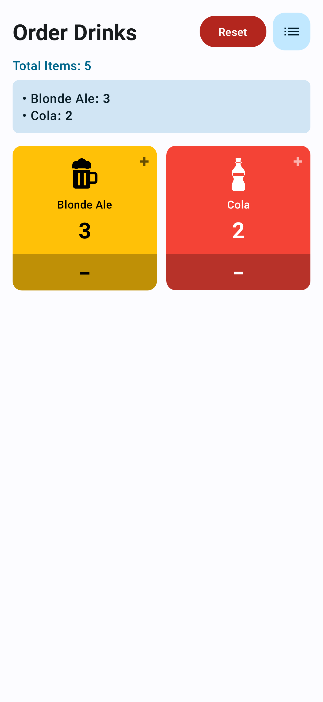

# 🍺 DrinkOrder App

A simple and intuitive mobile app for managing drink orders and tracking item counts. Perfect for taking order 

## 📸 Screenshot

  

## ✨ Features

### 📱 Order Management
- **Grid View**: Browse all available drinks in a clean 2-column grid layout
- **Easy Ordering**: Tap + and - buttons to adjust quantities for each item
- **Live Counter**: See real-time count updates for individual items and total order
- **Order Summary**: View a bullet-point list of all selected items with quantities

### 📝 Item Management
- **Add Items**: Create new drink items with custom names
- **Drag & Drop**: Reorder items by long-pressing and dragging in the list view
- **Delete Items**: Remove unwanted items from your inventory

### 💾 Smart Storage
- **Persistent Data**: All items and order counts are automatically saved
- **Resume Orders**: Your selections persist even when switching between screens or closing the app
- **Reset Option**: Clear all order counts with a single tap

### 🎨 User Experience
- **Beer-themed Icon**: Custom beer mug app icon
- **Intuitive Navigation**: Easy switching between grid and list views
- **Clean Design**: Modern interface with clear visual feedback
- **Order Tracking**: Always see your current order summary at the top

## 🚀 How to Use

1. **Start Ordering**: The app opens to the main grid view showing all available items
2. **Select Items**: Tap the + button to add items to your order, - to remove
3. **View Summary**: See your order summary in the card below the total count
4. **Manage Items**: Tap the list icon to add new items or reorder existing ones
5. **Reset**: Use the Reset button to clear all selections and start fresh

## 🎬 Development

This app was created through **vibe coding with Claude Code** - demonstrating real-time AI-assisted development and modern Android app creation.

---

*Ready to streamline your drink ordering process? Install the APK and start managing your orders today!*